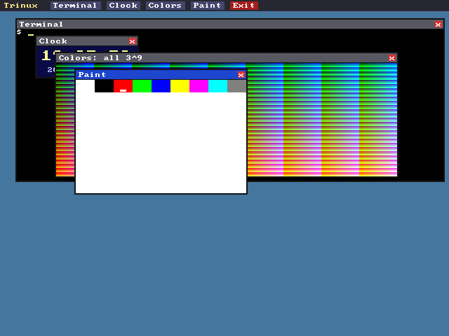

# Setun-11̅

Setun-11̅ (Setun-26): 11̅ is 26 in balanced base 27, one less than 3³.
"Setun-26" is the same name in ASCII, for file names (`docs/SETUN26_ISA.md`)
and places where the overline, a combining character, would be lost. The
repository is called Setun70 after the machine that started it; the design
was once called Setun-386.

A balanced-ternary computer sized like an Intel 386, with an emulator, BIOS,
compiler, kernel and window system. It is a new CPU designed from scratch and
named after the Soviet **Setun** computers (Brusentsov, Moscow State
University, 1958 and 1970). From them it keeps balanced arithmetic, the
tritwise multiply and threshold-add operations, and the 3-way branch.

**Everything is a power of 3:**

- 9-trit tryte (3²), the smallest addressable unit
- 27-trit word = register = pointer (3³)
- 3^27-tryte address space (3^3^3), paged 9|9|9 with 3^9-tryte pages
- default RAM 3^18 = 9^9 trytes (≈ 691 MB equivalent)
- 27 general registers, a load/store 3-operand ISA, a sign trit and a carry trit
- the floating-point unit (ISA §14): 27 real registers, real27 (9-trit exponent, 18-trit mantissa) and real81 (72-trit mantissa), where 1/3 is exact and 1/10 is not
- 3 privilege rings on one trit, 243 interrupt vectors, 3^9 I/O ports (a port number is one tryte)
- 640×480 framebuffer, one tryte per pixel = 3^9 colours (27 levels per channel)
- a tryte holds a Unicode code point directly



*Trinux on the emulator: `trwm term clock colors paint`. The Colors window shows every one of the 3^9 pixel colours once.*

The font covers Latin, Greek and the Cyrillic block. Here `cat /etc/pangrams` runs on the text console: ([screenshot](docs/screenshots/cyrillic-console.png))

## Docs

- [`docs/CPU.md`](docs/CPU.md): **the CPU manual**: registers, every instruction, the MMU, traps, devices and ports, the assembler, the ABI
- [`docs/TRINUX.md`](docs/TRINUX.md): **the Trinux manual**: the shell, every command, files, processes, signals, the window system, networking, system calls and libraries
- [`docs/TRINE.md`](docs/TRINE.md): **the Trine manual**: a tutorial and the complete language reference, builtins, the standard library, the compilers and their optimization levels
- [`docs/REAL.md`](docs/REAL.md): the real27/real81 floating-point standard, with its conformance vectors
- [`docs/FORMATS.md`](docs/FORMATS.md): the ternary data formats: tvarint balanced varints, TTV tagged values, TAU sound, TIM pictures
- [`docs/ECC.md`](docs/ECC.md): error correction for memory: SEC-DED [33,27,4], Hamming [31,27,3] and Golay [11,6,5] over GF(3), with a reference codec
- [`docs/SETUN26_ISA.md`](docs/SETUN26_ISA.md): the normative ISA specification (v0.7: integer, floating-point and vector instructions)
- [`docs/PERFORMANCE.md`](docs/PERFORMANCE.md): how the emulator runs fast without changing behaviour, and the benchmarks
- [`docs/LANGUAGE.md`](docs/LANGUAGE.md): Trine, the compact language reference
- [`docs/ASSEMBLER.md`](docs/ASSEMBLER.md): the assembly language and `setun-asm`
- [`docs/NOTATION.md`](docs/NOTATION.md): how balanced-ternary numbers are written (the overlined digits, `0t`/`0z` literals)
- [`docs/SELFHOST.md`](docs/SELFHOST.md): self-hosting: `tas` and `tric`, Trinux's own assembler and compiler (`-O0` to `-O4`, the host's output to the character)
- [`docs/TERNARY_WORLD.md`](docs/TERNARY_WORLD.md): the plan for a more ternary system, phase by phase
- [`docs/BOOT.md`](docs/BOOT.md): the boot protocol
- [`docs/KERNEL.md`](docs/KERNEL.md): Trinux's kernel, milestone by milestone (K1–K8, users, the FPU, networking, shared memory, the vector unit)
- [`docs/TNET.md`](docs/TNET.md): the native ternary network between Setun machines: the `TLINK` card, TL frames with a TCRC-18 check over GF(3), TNP addresses, TSP streams
- [`docs/NETWORK.md`](docs/NETWORK.md): networking: the `TNIC` card, the host-side network, Trinux's TCP/IP stack and sockets, telnet and SSH logins, TLS for `wget`, a web server
- [`docs/IPV6.md`](docs/IPV6.md): IPv6 beside IPv4: Neighbor Discovery, autoconfiguration, ICMPv6, `AF_INET6` sockets, the gateway's NAT and AAAA answers
- [`docs/ROADMAP.md`](docs/ROADMAP.md): build order and milestones
- [`docs/ARCHITECTURE.md`](docs/ARCHITECTURE.md) and [`docs/reference/`](docs/reference/README.md): the historical Setun-70 and its sources (heritage and background only)

## Layout

| Path | What |
|---|---|
| `crates/ternary` | balanced-ternary fixed-width integers (`Trit`, `Tryte`, `Word`, `Tern<N>`) |
| `crates/real` | real27/real81 floating point, correctly rounded, and its conformance vectors ([`docs/REAL.md`](docs/REAL.md)) |
| `crates/ecc` | the reference encoders and decoders of the error-correcting codes ([`docs/ECC.md`](docs/ECC.md)) |
| `crates/core` | emulator core (`setun-core`): CPU, traps, 9\|9\|9 MMU, memory map, devices (interrupt controller, timer, RTC, keyboard, mouse, serial, DMA disks, display renderer), `Machine` |
| `crates/asm` | assembler, disassembler and the `setun-asm` tool ([`docs/ASSEMBLER.md`](docs/ASSEMBLER.md)) |
| `crates/demo` | demo ROM in assembly ([`demo.s`](crates/demo/src/demo.s)): text screen, keyboard/serial echo, 3^9-colour graphics |
| `crates/native` | native front end, binary `setun`: window, keyboard/mouse, serial on stdio, `--net`, `--net6` |
| `crates/net` | `setun-net`: the network behind the card, a user-mode gateway (10.0.2.2) on smoltcp with port forwards |
| `crates/web` + `web/` | browser front end: WebAssembly exports (with the BIOS and the Trinux disk built in) and the front-panel page |
| `crates/trine` | the Trine compiler (binary `trine`) and its standard library (`lib/`) |
| `examples/` | Trine programs, e.g. `mandel.tri` |
| `bios/` | the BIOS (`bios.tri`, built into `setun`) and a sample boot sector |
| `kernel/` | Trinux, the kernel (Trine) |
| `user/` | Trinux user programs and `tlibc` |
| `crates/trinux` | `mkdisk`: builds bootable Trinux disks; the tests that boot Trinux |
| `crates/bench` | `setun-bench`: benchmarks, with a hash of the whole machine's state so a faster emulator can be checked against the plain one |
| `crates/wtest` | the emulator's fast-path tests compiled to WebAssembly, for the browser build's JIT (run under node) |
| `user/lib/`, `user/bin/`, `user/etc/` | tlibc and the other libraries, the programs, the files of `/etc` |
| `user/share/` | conformance vectors that Trinux programs check (`fmtvec`, `ip6vec`) |
| `tools/` | the Python generators of conformance vectors and tables, each an independent model ([`tools/README.md`](tools/README.md)) |
| `fonts/unifont/` | GNU Unifont, packed into the disk image (see License) |

## Build and run

You need Rust (stable, edition 2021). Optional:

- `rustup target add wasm32-unknown-unknown`, for the browser build (`web/build.sh`);
- Python 3 with the `cryptography` package, to regenerate vectors (`tools/`);
- node, for the WebAssembly JIT's tests (`tools/wtest.mjs`);
- `ssh`, `sftp`, `scp` (OpenSSH) and `openssl` on the PATH: the tests that check Trinux against them skip without them.

Images: `.t1b2` is a ROM or disk image, one tryte per little-endian 16-bit
number.

```
cargo run --release -p setun-native            # window: boots the BIOS (--demo: demo ROM)
cargo run --release -p trine -- build --boot bios/boot_hello.tri -o hello.disk
cargo run --release -p setun-native -- --disk hello.disk     # BIOS boots it
cargo run --release -p setun-native -- --help  # every option
cargo run --release -p trine -- run examples/hello.tri        # compile + run headless
cargo run --release -p trine -- build examples/mandel.tri -o mandel.t1b2
cargo run --release -p setun-native -- --rom mandel.t1b2      # watch it draw
cargo run --release -p trinux --bin mkdisk -- -o trinux.disk
cargo run --release -p setun-native -- --disk trinux.disk     # boot Trinux to a shell prompt
cargo run --release -p setun-native -- --console              # no window: this terminal is the console (ssh); Ctrl-] leaves
cargo run --release -p setun-native -- --console --net 2323:23 # with a network; then `telnet localhost 2323` logs in
cargo run --release -p setun-native -- --console --net 2222:22 # then `ssh -p 2222 root@localhost` (password root)
cargo run --release -p setun-native -- --console --net 8080:80 # then http://localhost:8080/ is Trinux's httpd
cargo run --release -p setun-native -- --console --net6 2222:22 # the same ssh, reaching Trinux over IPv6
sh web/build.sh                                # build web/setun.wasm (BIOS + Trinux disk inside; needs the wasm32-unknown-unknown target)
python -m http.server 8026 --directory web     # then open http://localhost:8026
```

The browser page boots Trinux from the built-in disk (3^7 pages of RAM). Log in
as `user` (password `user`) or `root` (password `root`), then type at the
prompt, or press **Window system** for `trwm term clock colors paint`.
Power-cycle keeps the disk, so files written in the browser survive a reboot;
**Fresh disk** restores it. The old demo ROM is still under **Boot**.

Speed: the browser build compiles hot code to WebAssembly as it runs (a JIT,
like the native one), and runs Trinux at a few hundred MIPS with the clock
unpaced, **Max** on the page (288 under node; 108 interpreted). The clock can
also be paced to a fixed speed.

Two machines over the native ternary network ([`docs/TNET.md`](docs/TNET.md)),
in two terminals:

```
cargo run --release -p setun-native -- --console --tlink listen:7000 --tlink-addr 0.0.1
cargo run --release -p setun-native -- --console --tlink connect:127.0.0.1:7000 --tlink-addr 0.0.2
```

then, logged in on the second, `ssh root@0.0.1` reaches the first over TNET.

## Tests

```
cargo test --release --workspace --exclude setun-web   # everything (about 500 tests; slow under full LTO)
cargo test --profile fast --workspace --exclude setun-web   # the same, without the LTO link: quicker to rebuild
cargo test --profile fast -p trinux --test ipv6        # one suite
cargo test --release -p trinux --test tls -- --ignored # also the one that reaches real web sites
```

Most of the suites boot Trinux in the emulator and talk to it over its serial
console and its network card (`crates/trinux/tests/`). The conformance
suites check the CPU, the floating point, the data formats, TNET and IPv6
against vectors made by independent models in `tools/`. Every milestone has
negative tests, and was checked by mutating the code and seeing a test fail.

## Security

The emulated machine is meant for a desk, not a network:

- Trinux has the accounts `root` and `user`, with the passwords `root` and
  `user`, and runs `sshd`, `telnetd` and `httpd`. Port forwards (`--net`,
  `--net6`) listen on 127.0.0.1 or ::1 unless an address is given; never
  give one that other machines reach.
- With `--net`, the guest can open connections to the internet and to every
  port of the host's own 127.0.0.1 and ::1 (as QEMU's user network does):
  services on the host that trust local connections trust the guest too.
  Without `--net` or `--net6` there is no network at all.
- `--tlink listen:PORT` listens on 127.0.0.1; `listen:ADDR:PORT` chooses the
  address. The first station to send becomes the peer, and frames from
  anyone else are ignored.
- The native front end runs a JIT: it generates machine code and runs it.

## Credits

The historical Setun-70 sources are collected, with the 1970 report's ALGOL
text transcribed, in Stanislav Maslovski's Setun-70 emulator,
[smaslovski/Setun70](https://github.com/smaslovski/Setun70); they are listed in
[`docs/reference/`](docs/reference/README.md), not copied here.

## License

MIT, see [LICENSE](LICENSE), except `fonts/unifont/`: GNU Unifont 18.0.01,
© Roman Czyborra, Paul Hardy and contributors, used under the SIL Open Font
License 1.1 ([`fonts/unifont/OFL-1.1.txt`](fonts/unifont/OFL-1.1.txt)). The
glyphs are packed into the Trinux disk image, and so into the web build, which
must carry that notice. Other third-party material (the root certificates,
Unicode data, the Rust crates the binaries link) is listed in
[NOTICE](NOTICE).
