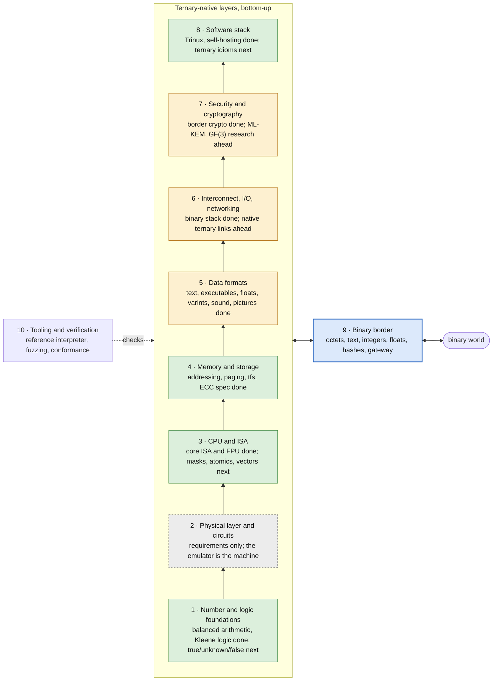
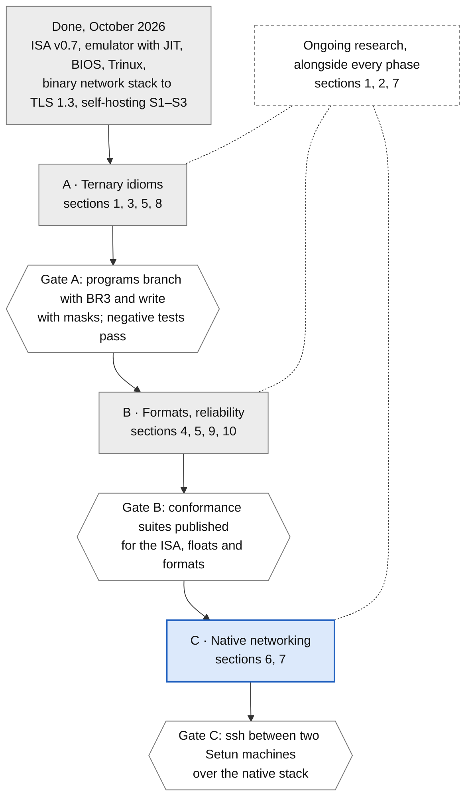

# Ternary World Roadmap

As of 2026-10-06, with the decisions of that day. Copied from the shared doc. The milestone plan for Setun-11̅ itself is in [`ROADMAP.md`](ROADMAP.md).

## Purpose and scope

Inside the ternary world everything is ternary-native, from the transistor to the file format; binary exists only at one border, behind adapters. This roadmap lists every layer that has to be redesigned, what the ternary version looks like, and where Setun-11̅ already stands.

Guiding principles:

1. **Balanced ternary everywhere.** Digits are −1, 0, +1. Ranges are symmetric, sign is free, rounding is truncation.
2. **Powers of 3 for every size.** Trit, tryte (9 trits), word (27 trits), page, block, address space.
3. **Use the third state, don't waste it.** A value with two states usually hides a third (unknown, pending, contended). If it truly has two, pack several into trits.
4. **Binary only at the border.** One adapter layer converts. Nothing inside depends on a binary format or a power of 2.
5. **Bottom-up, tested.** A layer is specified before the layer above relies on it, and every milestone ships with negative tests.

The sections run bottom-up. Each has a lead, a table of components (the ternary-native design, its gain over binary, Setun-11̅ status), and open questions. The physical layer is out of reach for an emulator project, so it is tracked as a requirements list, not a build plan.

## Map of major points

Setun-11̅ is ternary from the ISA up; silicon and native links remain. Eight layers stack from the number system up to software. Tooling (§10) checks all of them, and one border layer (§9) is the only place binary is allowed in.

Green: core done. Amber: the binary side is done, the ternary-native side is ahead. Grey: research only.

## 1. Number and logic foundations

The arithmetic is done: Setun-11̅ has balanced integers, tritwise logic and native rounding (ISA v0.6). What is missing is a three-valued logic that programmers and tools use as fluently as Boolean algebra.

| Component | Ternary-native design | Gain over binary | Status |
| --- | --- | --- | --- |
| Digits and notation | −1/0/+1; overlined digits; `0t` base-3 and `0z` base-27 literals | Sign and digit in one notation; negation toggles the bars | Done |
| Integers | Tryte ±9,841, word ±3.8×10¹²; no unsigned types | Symmetric ranges, no sign extension, one compare instruction | Done |
| Division | `DIVR` rounds to nearest; `MODR` remainder with \|r\| ≤ \|b\|/2 | Rounding falls out of the arithmetic | Done |
| Logic primitives | `MIN` (and), `MAX` (or), `NEG` (not), `TMUL`, `TSAT`, `CONS` (consensus) | Kleene logic in one instruction; consensus has no binary equivalent | Done |
| Truth type in languages | Trine already has `trit`, `&` (min), `\|` (max), `~` (= `-x`), `<=>` and `sign`. Missing: `true`/`unknown`/`false` as +1/0/−1, `TRUE`/`FALSE` for binary logic, and refusing `if` on a trit (§A1) | NULL, `Option` and "not known yet" without a separate flag | Partial |
| Logic algebra and minimization | Canonical forms and minimizers (ternary Karnaugh maps, Quine–McCluskey) for 3-valued functions | Compilers and chip design need them; the binary versions don't apply | Research |
| Packing two-state data | `lib/flags.tri`: 42 two-state flags per word (a 42-bit two's complement number, 98% of the word's information), and Kleene vectors of 27 truth values per word, where `&`, `\|`, `~` act on all 27 lanes at once and `TCP`/`TCN` count the true and false ones | Recovers the 0.415 bit lost per flag stored alone | Done |

Decided 2026-10-06:

- Trine's existing `trit` type is the Kleene truth type, with `&`, `|` and `~` as and, or, not, and `true` = +1, `unknown` = 0, `false` = −1. Binary logic uses `FALSE` = 0 and `TRUE` = `!FALSE`. An `if` on a trit does not compile; the program must say what unknown does, with `sign` (§A1).
- Packed flags start as a tlibc library. They become a language feature only if they see heavy use.

## 2. Physical layer and circuits

This layer is a requirements list: the emulator is the reference machine, and any hardware must match it state for state. The premise is a ternary switch as fast and frugal as a binary transistor; everything here assumes it.

| Component | Ternary-native design | Gain over binary | Status |
| --- | --- | --- | --- |
| Switching device | Three stable states per device, for example multi-threshold carbon-nanotube FETs | The premise of the whole stack | Research |
| Signal levels | Balanced −V / 0 / +V, with 0 at ground | DC-balanced wires; the cost is half the noise margin at the same swing | Research |
| Gate library | Standard cells for `NEG`, `MIN`, `MAX`, `CONS`, `TSAT`, a 3-way multiplexer, half and full adders | One cell per ISA logic operation | Research |
| Adders | Balanced full adder: sum and carry each in {−1, 0, +1}; ternary carry-lookahead | Carry chains about 37% shorter for the same range | Research |
| Multipliers | Partial products are only 0, +x or −x | No Booth recoding; 27 partial products instead of 43 | Research |
| Storage cells | Ternary latch, flip-flop and SRAM cell with three stable states | Registers and caches hold 1.585 bits per cell | Research |
| Clock and static power | A two-phase clock is fine; the middle level must not draw static current | If the 0 state leaks, ternary loses its power case | Research |

Decided 2026-10-06:

- No device family is picked. The roadmap watches CNTFET, multi-threshold CMOS and others, and the emulator stays the reference until one is real.
- No FPGA prototype: the emulator is the only machine. Hardware work is ongoing research, not a phase.

## 3. CPU architecture and ISA

The Setun-11̅ core is ternary-native already: one sign trit replaces the zero and sign flags, and every branch can go three ways. The gaps are the instructions that make the third state pay off in everyday code: masked writes, three-state atomics and vectors.

| Component | Ternary-native design | Gain over binary | Status |
| --- | --- | --- | --- |
| Status and branches | `S` = sign of the last result; `BR3` jumps on <, = or > | One compare drives a three-way branch; no Z/N/V flag zoo | Done |
| Carry | Carry trit `C`, non-zero exactly on overflow; `ADC`/`SBC` | Overflow detection and multi-word arithmetic from one trit | Done |
| Privilege | 3 rings on one trit: user, drivers, kernel | Driver ring for free, without a binary 4-ring waste | Done |
| Floating point | real27 and real81 sharing a 9-trit exponent; no sign trit, no −0; truncation rounds to nearest | No guard/sticky bits; reading the first word of a real81 gives the rounded real27 | Done |
| Trit-mask merge | An ALU merge of a source into a register under a mask (0 keeps, +1 takes the source, −1 clears), plus a masked word store for device registers and shared flags: `MRG` and `STWM` (§A2) | Sets, clears and keeps fields in one write; binary needs AND then OR | Done |
| Three-state atomics | Lock word free / held / contended; compare-and-swap that reports <, = or >: `CAS3`, and tlibc's one-trit mutex (§A4) | Futex-style locks without a second waiter flag | Done |
| Vectors | 27 new 81-trit vector registers, saved lazily like the FPU, as 9 tryte lanes or 3 word lanes, with `MIN`, `MAX`, `TMUL` per lane (ISA §15) | Text, pixels and small integers in parallel | Done |
| Ternary-weight dot product | `VDOTW`: a sum over lanes with weights in {−1, 0, +1} | Ternary neural networks (BitNet b1.58 style) run with no multiplier at all | Done |

Decided 2026-10-06:

- The trit-mask merge comes in two forms: a register merge under the ALU major, and a masked word store that writes memory directly.
- Vectors get 27 new 81-trit registers, switched lazily like the FPU registers.

## 4. Memory and storage

Addressing and paging are done and are powers of 3 throughout. Still to design: error correction, caches, and the persistent storage cell. Ternary is stronger than binary at error correction, so ECC is the first item to add.

| Component | Ternary-native design | Gain over binary | Status |
| --- | --- | --- | --- |
| Address space | 3^27 trytes, addressed by the centre; aligned means the address is a multiple of the size | No canonical-form rule; alignment is one divisibility test | Done |
| Paging | 9 \| 9 \| 9 split, 3^9-tryte pages, one-word page-table entries with a 3-valued `RING` field | Each level indexes by one tryte, with no shifting or masking | Done |
| Physical allocator | "triddy": a buddy allocator that splits blocks in 3 | Free blocks stay powers of 3 | Done |
| Memory ECC | [`ECC.md`](ECC.md): SEC-DED [33,27,4] for memory words (6 check trits whose columns form a cap in PG(5,3), of the least possible weight); the shortened Hamming code [31,27,3] (4 check trits, single correction); the perfect Golay code [11,6,5] for short fields that must survive 2 errors. The syndrome, read as a balanced number, names the wrong trit. Specified for hardware only, with a reference codec in `crates/ecc` tested on every error pattern | One check trit covers both error values (one level or two); SEC 14.8%, SEC-DED 22% (binary SEC-DED on the same 42.8 bits: 16%); Golay has no binary equal | Done (spec) |
| Caches | Lines of 27 or 81 trytes; 3-way or 9-way sets; set counts a power of 3, indexed by address trits | The index is a trit field, never a modulo | Planned |
| Disk layout | Sector = 1 block = 3^9 trytes; `tfs` with 81-tryte directory entries, 243 per block | The file system needs no binary sizes | Done |
| Storage cell | A 3-level flash or resistive cell holding exactly one trit | Today's multi-level flash already stores levels; 3 levels give the widest margin per trit | Research |

Decided 2026-10-06:

- ECC is written down as a specification for future hardware. The emulator stays error-free and does not model check trits. **Done 2026-10-08:** [`ECC.md`](ECC.md) and `crates/ecc`; memory words use SEC-DED [33,27,4] rather than the [31,27] SEC planned first, because SEC turns some double errors into a third wrong trit.
- `tfs` gets no checksums for now.

## 5. Data formats

Formats are where a ternary world either stays ternary or quietly turns into binary carried in trits. The rule: every format counts in trytes and stores signed values in balanced form, never in an offset or a zigzag encoding.

| Format | Ternary-native design | Gain over binary | Status |
| --- | --- | --- | --- |
| Text | One Unicode code point per tryte; an overlined character is the negated code point | Fixed width, no UTF-8 decoding, overline for free | Done |
| Text beyond U+2671 | A lead tryte (−2 plain, −3 overlined) followed by 2 trytes in −9841…−33 covers all of Unicode; built in tlibc, the UTF-8 border and the font path | CJK and emoji without giving up one tryte per common character | Done |
| Floating point standard | real27 / real81 written up as a standalone standard ([`REAL.md`](REAL.md)): formats, rounding, operations, exceptions, text conversion; 14,000 conformance vectors from an independent exact reference, which the library and the FPU both pass | A ternary IEEE 754 that other ternary machines can adopt | Done |
| Images | 27 levels per channel, 3^9 colours per tryte; TIM ([`FORMATS.md`](FORMATS.md)), a lossless format of 1 to 9 trits a sample whose median-edge prediction residuals are stored as balanced varints, with runs of zeros in one tryte; `ppm2tim`, `tim2ppm`, `timview` | Residuals are signed by nature, so balanced storage needs no offset | Done |
| Audio | Balanced samples of one word (3 trytes, about 42.8 bits). A tryte (14.3 bits) falls short of 16-bit audio, and 2 trytes is not a power of 3. TAU ([`FORMATS.md`](FORMATS.md)); `wav2tau`, `tau2wav` (exact round trips for 8, 16 and 24 bits), `tone` | Silence is 0 with no DC offset; the range is symmetric | Done |
| Serialization | tvarint: balanced varints of 8-trit groups and a control trit, canonical, for int and `long`; TTV: tagged values (null, truth, integer, real, text, octets, list, map) in trytes ([`FORMATS.md`](FORMATS.md)); the `ttv` tool and its text notation | Signed varints need no zigzag trick; a truth is one trit-valued tryte | Done |
| Compression | Entropy coding in base 3 | Arithmetic coding over three symbols wastes nothing on binary rounding | Planned |
| Executables | TEF, the Trinux executable format | Already tryte-native | Done |

Decided 2026-10-06:

- Code points beyond U+2671 (CJK, emoji) are implemented now: 3 trytes per character: a lead tryte (−2, or −3 for an overlined character; −1 is left alone because `fgetc` returns it for end of file) and 2 trytes of code point, each in −9841…−33.
- A timestamp is one word of seconds around the 1970 epoch (±120,000 years, no 2038 problem). Sub-second time is a `long` (81 trits): seconds in the top word, a base-3 fraction of a second in the lower 54 trits. **Done 2026-10-08:** inodes keep atime, mtime and ctime (relatime), `utimensat`; `time.tri` has `gmtime`/`timegm` for any year and the `ltime_*` functions on `long`; `touch`, `ls -l -t -u -c`, `date -d -r %N`, `stat`, `find -newer -mtime -mmin`, `sleep 0.25` and `time` use them.

## 6. Interconnect, I/O and networking

Today every Setun-11̅ network packet is binary: `TNIC` carries one octet per tryte to a binary Ethernet. A native stack only pays off once two ternary machines talk, so its first milestone is two emulators linked trit to trit.

| Component | Ternary-native design | Gain over binary | Status |
| --- | --- | --- | --- |
| Port I/O | A port number is one tryte; a port transfers a word | Already native | Done |
| On-chip buses | 27 lines per word instead of 43 | About 37% fewer wires, where most delay and power go | Research |
| Chip-to-chip links | Balanced 3-level signalling, one trit per symbol | Industry PAM3 (GDDR7, 100BASE-T1) maps 3 bits onto 2 symbols; native trits need no mapping | Research |
| Peripheral bus | A ternary serial bus with balanced line coding; the 0 symbol doubles as idle and frame marker | DC-free by construction; framing without bit stuffing | Planned |
| Link layer | Ternary frames, 27-trit station addresses, ternary checksums | No octet packing inside the ternary network | Planned |
| Network and transport | A native protocol: 27-trit or 81-trit host addresses, word-sized sequence numbers and windows | 3^27 ≈ 7.6×10¹² addresses in one word, about 1,800 times as many as IPv4 | Planned |
| Binary networking | IPv4, TCP, UDP, DNS, SSH, TLS 1.3 and HTTP through the `setun-net` gateway | Reaches the binary internet today | Done |

Decided 2026-10-06:

- The native stack keeps BSD sockets, with a new ternary address family, so `ssh`, `wget` and `httpd` run over both stacks.
- Native networking comes before IPv6. IPv6 is added only if the binary side needs it.

## 7. Security and cryptography

Cryptography is the one layer where "design our own" is dangerous: a cipher is trusted only after years of public attack. So the plan has two tracks: binary standard crypto stays for the border, and the ternary-native track starts with lattice schemes that are already standardized and happen to be ternary-friendly.

| Component | Ternary-native design | Gain over binary | Status |
| --- | --- | --- | --- |
| Border crypto | SHA-2, ChaCha20-Poly1305, AES-GCM, X25519, Ed25519, ECDSA, RSA, on the ISA v0.6 binary operations | Talks to the real internet today | Done |
| Random numbers | `TRNG` device and `/dev/urandom`; converting bits to trits by rejection (8 bits below 243 give 5 trits) | Unbiased trits, which naive bits mod 3 is not | Partial |
| Post-quantum public key | Lattice schemes whose secrets are small balanced numbers: NTRU uses exactly −1, 0, +1; ML-KEM and ML-DSA use small coefficients around 0. ML-KEM comes first; NTRU follows | Standard algorithms, and the native number format fits them | Planned |
| Symmetric cipher | A design over trits: add mod 3^27, trit rotations, `TMUL` and consensus as the non-linear layer. Research only, never for real secrets | No binary operations inside the ternary world | Research |
| Hash | A sponge over trits | IOTA's ternary hash Curl-P was broken in 2017, a warning that a new design needs public review; research only | Research |

Decided 2026-10-06:

- A ternary cipher and hash are research toys, built and published for study. Real secrets always use standard algorithms.
- ML-KEM (FIPS 203) is the first native public-key target, because it also works with binary peers.

## 8. Software stack

The system software exists and builds itself: Trinux, tlibc, Trine and the `tas`/`tric` toolchain. The next step is to make programs think in trits, not just run on them: three-way control flow in the language, trit operations in place of bit tricks, and data structures that branch by 3.

| Component | Ternary-native design | Gain over binary | Status |
| --- | --- | --- | --- |
| Operating system | Trinux: POSIX interfaces, a tryte is the "byte" (`CHAR_BIT` = 9), text in code points | Unix programs port with few changes | Done |
| Language and compiler | Trine; `tric` compiles itself to a fixed point | The ecosystem grows from inside the machine | Done |
| Three-way control flow | `sign (a <=> b) { neg: … zero: … pos: … }`, compiled to one `CMP` and one `BR3` | The C convention (<0, 0, >0) becomes a first-class branch | Done |
| Trit operations in place of bit tricks | `TLZ` (leading zero trits), `TCP`/`TCN` counts, `TREV` reversal (§A3), packed flag sets and Kleene vectors (`lib/flags.tri`) | Replaces popcount, clz and bitmask idioms | Done |
| Data structures | 3-ary heaps (`lib/heap3.tri`) and B-trees with 27 keys per node (`lib/btree.tri`, 3000 keys in 3 levels) are done, both with three-way compares (`sign`); hash tables of 3^k buckets indexed by trits and ternary search tries are next | Wider fan-out means shallower trees | Partial |
| Algorithms | Radix sort in base 27; radix-3 FFT and number-theoretic transforms | Natural digit size, no conversions | Planned |
| Optimizer in `tric` | The host optimizer split into four cumulative levels and ported level by level: `tric -On` writes exactly the host's assembly at each (SELFHOST.md) | Optimized builds made on the machine itself | Done |

Decided 2026-10-06:

- The library keeps binary search for sorted arrays. Splitting by 3 costs about 1.26× the compares, so ternary fan-out is used only in wide nodes (B-trees, tries).

## 9. The binary border

The border is one thin layer of adapters, and nothing above it knows binary exists. Each adapter has one conversion rule, and data crossing it is either exact or flagged as rounded.

| Crossing | Rule | Exact? | Status |
| --- | --- | --- | --- |
| Binary operations | `BAND`, `BOR`, `BXOR`, `BANDN`, `BSH`, `BEXT`, `BROT` for data that comes from binary systems | Yes | Done |
| Octets | One octet per tryte on the wire (`TNIC`) | Yes | Done |
| Text | Code points ↔ UTF-8 at the border; an overlined character ↔ the character + U+0305 | Yes | Done |
| Hashes and signatures | Computed over the binary form (text hashed as UTF-8), so digests match other systems | Yes | Done |
| Integers | Two's complement ↔ balanced. A word holds any 32-bit integer; a `long` (3 words, 81 trits) holds any 64-bit one, and even any 128-bit one | Yes | Partial |
| Floating point | IEEE 754 ↔ real27/real81. Binary fractions are not finite in base 3 (1/2 = 0.111… in ternary), so this direction always rounds | No: keep IEEE values as bit patterns when exactness matters | Planned |
| Gateway | `setun-net`: the emulator's user-mode NAT to host sockets, DNS and the internet | Yes | Done |

Decided 2026-10-06:

- A 64-bit integer from binary lands in a `long`: 3 words, 81 trits, already in ISA §10 and planned for Trine. Power-of-3 sizes go tryte, word, long; there is no two-word type.

## 10. Tooling and verification

The emulator's reference interpreter is the definition of the machine, and every faster path must match it state for state. What is missing is conformance suites that let a second implementation (an FPGA, another emulator) prove it is the same machine.

| Component | Ternary-native design | Gain | Status |
| --- | --- | --- | --- |
| Reference and fast paths | Golden state hashes; a fast-vs-reference fuzz test; directed tests, each shown to catch its bug | JIT and optimizer cannot drift from the spec | Done |
| Negative tests | Every milestone ships tests of what must be refused: malformed literals, broken packets, bad syscalls | Bugs at the edges surface before users find them | Done |
| Conformance suites | Separate suites, each from an independent model of its specification: the ISA (ISA §16, about 3,900 vectors), real27/real81 (REAL.md §8, about 14,000), the formats (FORMATS.md §5); each native protocol to follow | A second implementation can be checked without reading the emulator | Done (protocols with phase C) |
| Fault injection | Flip trits on links and in packets to test checksums; memory faults wait for hardware ECC | Proves the error handling actually works | Planned |
| Ternary EDA | A hardware description language with a balanced trit type; a gate-level simulator for ternary cells | Needed before any ternary silicon or FPGA work | Research |

## Phased roadmap

Ternary idioms come first; hardware stays research. Phases run in order, and each gate must pass before the next phase starts.

| Phase | Work |
|---|---|
| A · Ternary idioms (done, 2026-10-07) | `true`/`unknown`/`false` as +1/0/−1 and `if` on a trit refused in Trine; trit-mask merge and masked store; trit counts, packed flags, 3-ary heaps, wide B-trees; `tric` optimizer; vector registers, three-state atomics; text past U+2671 in 3 trytes |
| B · Formats, reliability (done, 2026-10-09: Gate B passed) | real27/real81 standard with a conformance suite; ECC as a hardware spec; balanced varints, word audio, image formats; `long` and timestamps in Trine; conformance suites for the ISA and the formats |
| **C · Native networking** (next) | Two emulators linked trit to trit; ternary link layer and protocol; BSD sockets over both stacks; ML-KEM first, then NTRU |
| Ongoing research | Ternary cipher and hash (study only), logic minimization; devices (CNTFET, multi-threshold CMOS), ternary HDL, gate simulator |

Phase A comes first because it is software only and makes every later layer think in trits. There is no hardware phase: the emulator is the only machine, and devices, HDL and circuits stay ongoing research (decided 2026-10-06).

## Phase A in detail

Phase A is software and ISA work on the emulator, in six parts. Each part lists its design, what already exists, and the negative tests that gate it. Encodings use free slots: ALU functions above 27, 1-word majors 8 to 11, MODE trit 19 and vector −13 are all unused in ISA v0.6.

### A1. Kleene logic in Trine ✅

**Done (2026-10-06):** in the host compiler and in `tric`, with the same messages (checked by the self-hosting tests, which also compile a program using the truth values with both and compare the assembly). The migration was empty: no Trine code used `true`, `false` or `unknown`, and no condition tested a trit. `&`, `|` and `*` of two trits and `~` of a trit are now typed `trit`, so Kleene functions can return them.

Trine already has most of a three-valued logic. `trit` is a type, `&` and `|` are tritwise min and max, `~x` is `-x`, `<=>` returns a trit, and `sign (e)` branches three ways on one `BR3`. What is missing is a consistent meaning of true and false.

**The conflict.** Kleene logic built on min and max needs false = −1, unknown = 0, true = +1. Trine today has `true` = 1 and `false` = 0, and a condition is true when it is non-zero. Under that rule a trit of −1 counts as true, which is the opposite of Kleene false.

**Decided 2026-10-06: ternary first.** The plain names are the ternary truth values, and binary truth gets its own names for translated binary logic.

| Name | Type | Value | Meaning |
|---|---|---|---|
| `true` | `trit` | +1 | Kleene true |
| `unknown` | `trit` | 0 | Kleene unknown (a new keyword) |
| `false` | `trit` | −1 | Kleene false |
| `FALSE` | `int` | 0 | binary false, as in C |
| `TRUE` | `int` | `!FALSE` = 1 | binary true; any non-zero value tests as true |

The binary constants were first spelled `b_true` and `b_false`; they became `TRUE` and `FALSE` on 2026-10-08, so that the two kinds of truth differ at a glance (lower case ternary, upper case binary).

Binary logic keeps its usual rule, false is 0 and true is "not false", so +1 and −1 both test as binary true. That rule now lives only in the `b_` names and in conditions on integers.

| a & b (min) | b = `false` | b = `unknown` | b = `true` |
|---|---|---|---|
| a = `false` | `false` | `false` | `false` |
| a = `unknown` | `false` | `unknown` | `unknown` |
| a = `true` | `false` | `unknown` | `true` |

`|` is the same table with max, and `~` swaps `true` and `false`. Implication is `~a | b`. This is Kleene's logic, not Łukasiewicz's: unknown implies unknown gives unknown.

Rules:

- A condition (`if`, `while`, `for`, `?:`, `!`, `&&`, `||`) takes an integer, tested the binary way: zero is false, anything else is true.
- An expression of type `trit` is refused as a condition, because the binary test would make `false` (−1) count as true. The error names the fix: `sign (t) { neg: … zero: … pos: … }`, or an explicit `t == true`.
- `if (a <=> b)` is refused by the same rule; the message suggests `a != b`.
- Comparisons (`<`, `==`, …) return `int` `TRUE` or `FALSE` and stay valid conditions.
- `true`, `false` and `unknown` do not convert to `int` implicitly. `t as int` is the explicit form.

**Migration.** This changes the value of `false` from 0 to −1, so silent changes of meaning must be impossible. The last rule makes every old use of `true` or `false` as an integer a compile error. `var done: int = false`, `while (true)` and `return true` from an `int` function each stop compiling, and the fix is `FALSE`, `loop { }` or `TRUE`. The compiler finds every line, and the fixes go in the same change as the rule. Today no Trine code uses `true`, `false` or `unknown` outside strings and comments, so the migration starts close to empty. The bootstrapped `tric` is rebuilt to its fixed point afterwards.

Negative tests: each refused form above gives its error and message; `true`, `false` and `unknown` assigned to an `int` without `as`; `unknown` as an identifier now refused; `t as int` accepted as a condition, because the program has said it wants integer truth; the S1–S3 fixed point still reached after the migration.

### A2. Trit-mask merge and masked store ✅

**Done (2026-10-06):** ISA v0.7 (§3.3, §3.4.1), the interpreter and both JITs (which hand MRG and STWM to the interpreter's code), the assembler and disassembler, and the Trine builtins `mrg` and `stwm` in the host compiler and `tric`. The negative tests listed below pass, and breaking the merge, its operand order or STWM's operands makes a test fail.

One mask trit per data trit says what happens: **0 keeps** the old trit, **+1 takes** the source trit, **−1 clears** to 0.

| Instruction | Encoding | Operation |
|---|---|---|
| `MRG rd, ra, b` | ALU function 28, all three forms | per trit i: `ra[i]` = 0 → `rd[i]` unchanged; +1 → `b[i]`; −1 → 0. Reads `rd`; sets S from the result |
| `STWM rd, [ra], rb` | new 1-word major 8 (`MEMR`), function 1, R format | the word at `ra` := merge(old word, `rd`, mask `rb`), as one atomic read-modify-write |

- With today's instructions a merge takes six ALU operations and four temporaries: `TMUL m,m` (where the mask is non-zero), `TMUL` with `rd` and a `SUB` to clear those trits, `MAX m,0` (where it is +1), `TMUL` with the source, and an `ADD`. The trits are disjoint, so no carries occur. `MRG` does it in one.
- `STWM` has no offset, because the R format has room for three registers and none for an immediate; the address is computed first (decided 2026-10-06). The address must be a multiple of 3 (else vector −5) and obeys page permissions (vector −4).
- Uses: page-table entry flags (`V`, `AD`, `RING`) updated in one store, device control registers, flag words shared between the kernel and drivers, and window-system dirty flags.

Negative tests: unaligned `STWM`; `STWM` to a read-only page; `MRG` with an all-zero mask (no change, S from the old value); reserved functions of major 8.

### A3. Trit counting and reversal ✅

**Done (2026-10-06):** as A2, with the builtins `tcp`, `tcn` and `trev`. `TREV` leaves the trits above the reversed field 0.

`TLZ` (ALU function 22) already counts leading zero trits. Three functions complete the set:

| Instruction | ALU function | Operation |
|---|---|---|
| `TCP rd, ra, b` | 29 | number of +1 trits in the low `b` trits of `ra` (`b` = 0 means all 27) |
| `TCN rd, ra, b` | 30 | number of −1 trits in the same field |
| `TREV rd, ra, b` | 31 | the low `b` trits of `ra` in reverse order (`b` = 0: all 27) |

- `TCP + TCN` is the number of non-zero trits; `TCP − TCN` is the trit balance. Together they replace binary popcount.
- `TREV` gives the trit-reversal permutation of a radix-3 FFT, the job bit reversal does in a radix-2 FFT.
- Trine gets builtins with the same names; packed flag sets (§1) use `TCP` to count set flags.

Negative tests: `b` outside 0…27 raises `ILL`; `b` = 9 on a tryte value; results on 0 and on the extreme words ±3,812,798,742,493.

### A4. Three-state atomics ✅

**Done (2026-10-06):** `CAS3` (MEMR function 2) in the interpreter, both JITs (by the interpreter's code), the assemblers (host and `tas`) and the disassembler; Trine builtins `cas3` and `swap` in both compilers. Trinux got what the mutex needs: shared anonymous memory (`mmap` with `MAP_SHARED | MAP_ANONYMOUS`: pages fork shares instead of copying, counted and freed with their last sharer) and `futex` (system call 98, WAIT and WAKE, keyed by the word's physical address). tlibc has `mtx_lock`/`mtx_unlock`. `/bin/mtxtest` checks all of it, with four processes hammering one counter under preemption (exact with the mutex; a run without it loses updates). Breaking the reference counting either way, the wake-up, or CAS3's store makes a test fail.

| Instruction | Encoding | Operation |
|---|---|---|
| `CAS3 rd, [ra], rb` | major 8 (`MEMR`), function 2 | `old` := word at `ra`; S := sign(`old` − `rd`), exact; if S = 0, the word := `rb`; then `rd` := `old`. Atomic |

A `BR3` right after `CAS3` sees three outcomes: the word was smaller than expected, equal (swapped), or larger.

A mutex fits one trit: **0 free, +1 held, −1 held with waiters**.

1. Lock: `CAS3` expecting 0, new value +1. Equal → done. Otherwise `SWAP` in −1; if the old value was not 0, sleep in a futex-style wait until woken, then retry.
2. Unlock: `SWAP` in 0. If the old value was −1, wake one waiter.

This is the classic futex mutex, which binary systems encode as 0/1/2. Here "held" and "held with waiters" are the two signs of one trit. Trinux needs a new wait/wake system call for it.

Negative tests: unaligned `CAS3`; `CAS3` on a read-only page leaves memory unchanged and raises vector −4; the three S outcomes each checked by a `BR3`; a lock stress test with preemption on.

### A5. Vector unit ✅

**Done (2026-10-06):** ISA §15 as below, with three changes found while building it. `MRG` is not a lane function (its number 28 is the first word-lane function); it is `VMRG`, VALU function 55, over all 81 trits. All three majors are R format, so `VMEM`'s offset is `q3` vectors (±117 trytes). `VDOTW` takes the lowest trit of each of `vb`'s tryte lanes as the weight. Built in the interpreter, both JITs (through the interpreter's code), the host assembler and disassembler, and `tas`. Trine and `tric` got memory-to-memory builtins (`vadd(d, a, b)` … `vsum`, `vdotw`, `vmrg`, `vbcst`) on `@align(9)` `[3]int` or `[9]tryte` arrays. Trinux switches the registers lazily (KERNEL.md §26). Tests: lane-by-lane models in the fast-path tests (native and wasm), assembler round trips and refusals, `tas` and `tric` matching the host on `/bin/vectest`, and `/bin/vectest` itself in Trinux. A mutation in each part (the enable check, `VDOTW`, `VST`'s all-or-nothing, a lane function, the compilers' address fix-up and merge, `tas`'s function table and `VLD`/`VST`, and the kernel's switching, fork, signal return and execve) fails a test.

- **Registers:** `v−13 … v13`, 81 trits each; `v0` reads as zero. A register is 9 tryte lanes or 3 word lanes.
- **Enable and lazy switching:** MODE trit 19 becomes `VE`. With `VE` = 0, any vector instruction raises vector −13 (vector unit not available), so Trinux saves and restores the registers only for tasks that use them, as for the FPU. The state is 26 × 9 = 234 trytes per task.

| Major | Name | Format | Operations |
|---|---|---|---|
| 9 | `VALU` | R on v registers | function 1–27: the ALU operation of that number on 9 tryte lanes; 28–54: the same on 3 word lanes. Only lane-wise operations are valid (`ADD`, `SUB`, `MIN`, `MAX`, `TMUL`, `TSAT`, `CONS`, `NEG`, `ABS`, `SGN`, `MRG`); others raise `ILL` |
| 10 | `VMEM` | Q | `VLD`/`VST` 9 trytes at `ra + 9·q3`; the address must be a multiple of 9 |
| 11 | `VMOV` | Q | lane `q3` to or from a general register; broadcast a general register to every lane |

Two reductions go under `VALU`:

- `VSUM rd, va`: `rd` (a general register) := the sum of the tryte lanes of `va`.
- `VDOTW rd, va, vb`: `rd` := Σ `va.tryte[j]` × `vb.trit[j]`, with one weight trit per lane. Each product is a pass, a negation or a zero, so no multiplier is needed. This is the inner loop of a ternary-weight neural network.

Trine gets these as builtins on a `[9]tryte` value first; a vector type can come later.

Negative tests: any vector instruction with `VE` = 0 raises −13 and changes nothing; unaligned `VLD`; a non-lane-wise function under `VALU`; lane index out of range in `VMOV`; a context switch between two tasks that both use vectors.

### A6. Text beyond U+2671 ✅

**Done (2026-10-06),** with two changes to the table below, both found while building it (ISA §8.4 has the final form):

- **The leads are −2 and −3, not −1 and −2.** `fgetc` returns −1 for end of file, and every character-at-a-time reader would have taken the lead for it (the shell did).
- **The trailing trytes are both in −9841…−33,** not the code point as an 18-trit number. As a plain number, the low tryte is 0 for 56 code points (U+4CE3 = 19683 is one), which would end a C string. The high tryte is 1…56, so for some characters it would equal a newline (10) or a space (32) and line or word splitting would cut the character in half. Now a trailing tryte is never NUL, ASCII or a lead, and an overlong form cannot be written at all.

Built: the `ternary` crate (`char_trytes`, `code_points`, `TextDecoder`, used by the assembler, both compilers' literals, the disk builder and the serial port, which carries them both ways); tlibc `tstr_next`, `tstr_chars`, `tchar_put`; UTF-8 at the border (`utf8_encode` takes a 3-tryte character tryte by tryte, `utf8_decode` refuses overlong forms, surrogates and anything above U+10FFFF, and `utf8_in_place` takes 4-octet characters); the shell's line editor inserts, deletes and steps over such a character whole. Tests: `/bin/chartest` (every edge value both ways, every malformed form), typing and echoing `日本̅ 😀` on the console, `tric` and `tas` matching the host on it, the serial device, and the `ternary` unit tests. Mutations in the library's checks, the decoder's overlong check, the editor, the serial port and the trailing-tryte range each fail a test.

The graphical side followed (2026-10-07): GNU Unifont 18.0.01 for planes 0 and 1 packed into `/usr/share/unifont` (KERNEL.md §21), `term` drawing in 8×16 Unifont cells with East Asian wide characters in two, and `edit`, the shell's line editor and the kernel's line discipline moving over and deleting a 3-tryte character whole, counting columns with `tchar_width`. Tests: every glyph reads back from the packed file; the terminal window shows `日本語 😀`, read off the screen cell by cell, with the columns after it lined up and the cursor where the grid says; both editors and the line discipline with wide characters. A mutation in the glyph decoder, `term`'s width, `edit`'s and the shell's column count, and the line discipline's erase each fail a test.

A character is 1 or 3 trytes:

| Character | Trytes |
|---|---|
| code point c ≤ 9841 | `c` |
| the same, overlined (c ≥ 33) | `−c` |
| code point c > 9841 | `−2`, then with n = c − 9842 the 2 trytes −(33 + n div 9809), −(33 + n mod 9809) |
| the same, overlined | `−3`, then the same 2 trytes |
| `−1`, `−4 … −32` | reserved: refused by every decoder |

This gives meaning to trytes −2 and −3, which ISA §1.1 now reserves ("−1…−32 mean nothing"), so §1.1 changes with it.

- The two trailing trytes give 9809² ≈ 96 million values, far more than Unicode's 1,114,112, so every code point fits.
- Every existing file stays valid, because all text today is at or below 9841.
- The form is not self-synchronizing: a trailing tryte can look like an ordinary character. Text is decoded forward from a known start, as Trinux does now. Backward scanning restarts from the line start.
- `strlen` keeps counting trytes. tlibc gets `tstr_next`, `tstr_chars` and a decoder that reports errors; `utf8_encode`/`utf8_decode` handle the escape at the border.
- The font path needs glyphs beyond the current 353 (Latin-1, Cyrillic, №): a 16×16 font for CJK, shipped in the disk image and loaded on demand.

Negative tests: a lead tryte at the end of a string; a code point above U+10FFFF; surrogates U+D800–U+DFFF; leads −3…−32; an escape that encodes a code point ≤ 9841 (an overlong form, refused as in UTF-8); round trips through UTF-8 for every edge value.

### Gate A ✅ (2026-10-07)

*Programs branch with BR3 and write with masks; negative tests pass.*

- **Three-way branches in real code.** `sign` compiles to one `CMP` and one `BR3`. It is used where a decision really is three-way:
  - the kernel's `fork`, on the page table's software trit (shared, private, already copy-on-write);
  - the binary searches in `wcwidth` (behind the shell, `term`, `edit` and every column count) and in `lib/btree.tri`, and the 3-ary heap's sift;
  - `sort -n`'s comparator, the shell's file-name completion (no slash, the root, a directory), `gfx` scrolling up or down, and `tric`'s operand formatting.

  7 of the 76 programs on the disk now contain `BR3` (15 sites), and so does the kernel.
- **Masked writes in real code.** The kernel marks a page copy-on-write in `fork`, and makes it writable again when its last sharer writes, with `STWM`. Two trits of the entry change (V and the software trit); the frame, the execute trit and the hardware's access trit stay. Before, the fault rebuilt the whole entry, which cleared the access trit. Other masked or trit-wise writes: the mutex (`mtx_lock`: `CAS3` and `SWAP`), and `lib/flags.tri`'s Kleene vectors (27 truth values per word, combined with tritwise min and max).
- **What stays two-way.** Most decisions in this code are two-way: a test, a bound, an error. Written as three-way branches they would be longer and no faster, so they stay `if`. Phase A's other items are done: packed flags, 3-ary heaps, B-trees, and the `tric` optimizer at all four levels.
- **Negative tests.** The full suite passes. Mutations in the converted code each fail a test: the copy-on-write mask in `fork` (`k3test`'s "child saw 43, parent still has 100"), the fault's mask, and `sort`'s comparator.

### Decided for phase A (2026-10-06)

- Truth values are ternary first: `true` = +1, `unknown` = 0, `false` = −1; binary logic uses `FALSE` = 0 and `TRUE` = `!FALSE` (§A1).
- `STWM` stays a 1-word instruction without an offset; the address is computed first.
- `VDOTW` takes one weight trit per lane, in the low trit of each of the 9 tryte lanes of `vb`.
- The 16×16 font ships in the disk image, under `/usr/share` next to `font8x8`, and `gfx.tri` loads it on demand (it became all of Unifont's planes 0 and 1, not only CJK).
